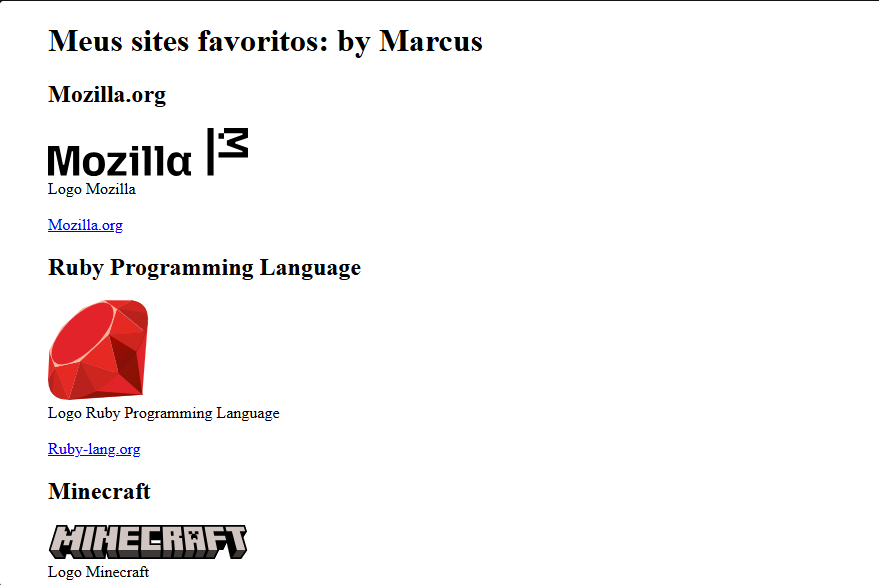

# Meus sites favoritos 

## Sobre

Esse é um site feito com HTML, onde eu mostro imagens de sites que eu mais gosto. Cada uma delas tem um link que leva para o site daquela imagem. Ele está disponível no Github Pages.

## Ferramenta Utilizada

* HTML

## Como testar

Acesse pelo link do GitHub Pages: <a href="https://marcuss25.github.io/sites-favoritos/" target="_blank">sites-favoritos</a>
